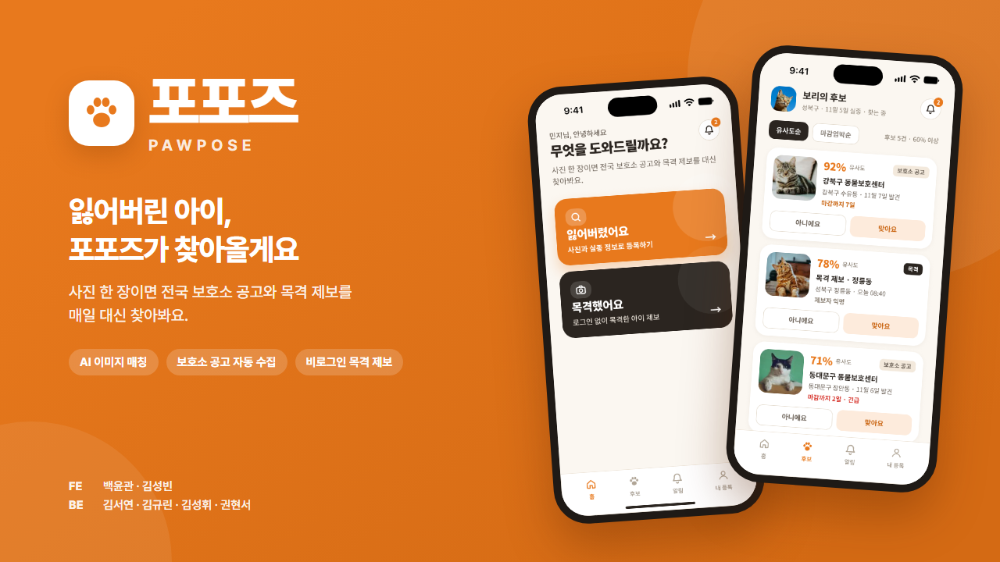

# 🐾 포포즈 Frontend

> 사진 한 장으로 전국 보호소 공고와 목격 제보를 매일 대신 찾아주는 실종 반려동물 찾기 서비스, **포포즈**의 프론트엔드 저장소입니다.

## 🚀 Deployment

> 🌐 [포포즈 바로가기 →](https://findpawpose.site)
>
> 📘 API 문서 [Swagger UI →](https://api.findpawpose.site/swagger-ui.html)

## 🛠️ 기술 스택

| 구분 | 기술 |
| :---: | --- |
| **Language** | JavaScript (ES6+) |
| **Framework** | React 19 |
| **Build** | Vite 8 |
| **Routing** | React Router DOM 7 |
| **Styling** | CSS Modules, CSS 변수 디자인 토큰, Pretendard |
| **API** | Fetch API (공통 `request` 래퍼) |
| **UI Library** | React DayPicker (날짜 선택), react-zoom-pan-pinch (사진 확대) |
| **External** | Kakao Login (OAuth), Kakao Local API (좌표 → 시군구), Geolocation API |
| **Lint** | ESLint 10, eslint-plugin-react-hooks |
| **Deploy** | Vercel |

## 📱 화면 구성

| 경로 | 화면 | 로그인 |
| --- | --- | :---: |
| `/` | 스플래시 (로그인 여부에 따라 홈 · 시작 화면으로 이동) | - |
| `/start` | 시작 화면 | - |
| `/login`, `/signup` | 이메일 로그인 · 회원가입 | 비로그인 전용 |
| `/oauth/kakao/callback` | 카카오 로그인 처리 | - |
| `/sightings/new` | 목격 제보 · 제보 결과 | 필요 없음 |
| `/home` | 홈 | ✅ |
| `/lost-pets/new` | 실종 등록 | ✅ |
| `/candidates` | 매칭 후보 목록 (유사도순 · 마감임박순) | ✅ |
| `/candidates/:candidateId` | 공고 · 목격 제보 상세 | ✅ |
| `/notifications` | 알림 목록 | ✅ |
| `/my`, `/my/:petId/edit` | 내 등록 · 등록 정보 수정 | ✅ |

## 💡 구현 포인트

### API 레이어 분리
- 화면은 `src/apis/*` 함수만 호출하고, 실제 요청은 `apis/client.js`의 공통 `request`가 처리합니다.
- 백엔드 응답 형식 `{ data, message, code }`에서 `data`만 꺼내 돌려주고, 실패 시 서버 문구를 담은 `ApiError`를 던져 화면이 그대로 보여줄 수 있게 했습니다.
- 네트워크 오류는 하나의 문구로 통일해 오류 화면과 다시 시도 버튼을 일관되게 보여줍니다.

### 인증 · 라우트 가드
- 액세스 토큰을 저장하고 `AuthProvider`가 앱 시작 시 `/auth/me`로 로그인 상태를 확인합니다.
- `RequireAuth`는 로그인이 필요한 화면을, `GuestOnly`는 로그인 · 회원가입 화면을 보호합니다.
- 토큰이 만료되면(401 `TOKEN_EXPIRED`) 로그인 화면으로 이동하고, 로그인 후 원래 보던 화면으로 돌아갑니다.

### 카카오 로그인
- 카카오 인가 화면 → `/oauth/kakao/callback`에서 인가 코드를 받아 `POST /auth/kakao`로 토큰을 발급받습니다.
- 로그인 전 보던 화면을 기억했다가 로그인 후 그 화면으로 돌려보냅니다.

### 위치 자동 입력
- 목격 제보 시 Geolocation으로 현재 좌표를 얻고 Kakao Local API로 **시군구 단위**로 바꿔 자동 입력합니다.
- 위치 권한이 거부되면 시도 · 시군구를 직접 고르도록 안내합니다.

### 분석 대기 · 자동 갱신
- 사진 분석과 매칭은 서버에서 비동기로 처리됩니다.
- 분석 중이면 서버가 알려준 `retryAfterSeconds` 뒤에 후보 목록과 제보 결과를 다시 조회하고, 그동안 로딩 · 분석 중 화면을 보여줍니다.

### 디자인 시스템
- 색 · 간격 · 모서리 · 글꼴을 `styles/tokens.css`의 CSS 변수로 관리하고, 컴포넌트마다 CSS Modules로 스타일을 분리했습니다.
- 모바일 화면(375px)을 기준으로 설계하고, 로딩 스켈레톤 · 빈 상태 · 오류 화면을 화면마다 따로 구성했습니다.

## 📁 폴더 구조

```
src
├─ apis         백엔드 API 호출 (client.js 공통 요청)
├─ assets       아이콘 · 이미지
├─ components   공통 · 화면 단위 컴포넌트
├─ constants    상수 · 문구
├─ hooks        화면 로직 훅
├─ layouts      하단 탭 레이아웃
├─ pages        라우트별 화면
├─ routes       라우트 · 로그인 가드
├─ styles       디자인 토큰 · 전역 스타일
└─ utils        날짜 · 이미지 등 유틸
```

## ⚙️ 실행 방법

```sh
npm ci
cp .env.example .env
npm run dev
```

| 환경 변수 | 설명 |
| --- | --- |
| `VITE_API_BASE_URL` | 백엔드 API 주소 (`https://api.findpawpose.site`) |
| `VITE_KAKAO_REST_API_KEY` | 카카오 REST API 키 (로그인 · 위치 변환) |

| 명령어 | 설명 |
| --- | --- |
| `npm run dev` | 개발 서버 실행 |
| `npm run build` | 배포용 빌드 |
| `npm run lint` | ESLint 검사 |
| `npm run preview` | 빌드 결과 미리보기 |

## 🎯 Git Convention

| 이모지 | 타입 | 설명 |
| :---: | --- | --- |
| 🎉 | Start | Start New Project `:tada:` |
| ✨ | Feat | 새로운 기능 추가 `:sparkles:` |
| 🐛 | Fix | 버그 수정 `:bug:` |
| 🎨 | Design | CSS 등 사용자 UI 디자인 변경 `:art:` |
| ♻️ | Refactor | 코드 리팩토링 `:recycle:` |
| 🔧 | Settings | 설정 파일 수정 `:wrench:` |
| 🗃️ | Comment | 필요한 주석 추가 및 변경 `:card_file_box:` |
| ➕ | Dependency/Plugin | 라이브러리 추가 `:heavy_plus_sign:` |
| 📝 | Docs | 문서 수정 `:memo:` |
| 🔀 | Merge | 브랜치 병합 `:twisted_rightwards_arrows:` |
| 🚀 | Deploy | 배포 관련 작업 `:rocket:` |
| 🚚 | Rename | 파일 및 폴더 이름 수정 `:truck:` |
| 🔥 | Remove | 파일 삭제 `:fire:` |
| ⏪️ | Revert | 이전 버전으로 롤백 `:rewind:` |

## 🌲 Branch Convention

| 브랜치 | 설명 | 예시 |
| --- | --- | --- |
| `main` | 배포 가능한 브랜치 | |
| `develop` | 개발 브랜치 | |
| `feat/#이슈번호/명칭` | 새로운 기능 개발 브랜치 | `feat/#12/login` |
| `fix/#이슈번호/명칭` | 버그 수정 브랜치 | `fix/#12/mission-state` |
| `ui/#이슈번호/명칭` | UI 작업 브랜치 | `ui/#12/home` |
| `docs/#이슈번호/명칭` | 문서 작성 및 수정 브랜치 | `docs/#12/readme` |
| `api/#이슈번호/명칭` | API 연동 작업 브랜치 | `api/#12/home` |
| `refactor/#이슈번호/명칭` | 리팩토링 작업 브랜치 | `refactor/#12/component-structure` |

## 🌊 Git Flow

1. Issue 생성
2. 최신 `develop` 브랜치에서 작업 브랜치 생성
3. 기능 개발 및 커밋 진행
4. `develop` 브랜치로 Pull Request 생성
5. 코드 리뷰 진행
6. 리뷰 완료 후 `develop` 브랜치로 병합
7. 병합 완료 후 작업 브랜치 삭제

## 📜 오픈소스

| 이름 | 용도 | 라이선스 |
| --- | --- | --- |
| [React](https://github.com/facebook/react) | UI 라이브러리 | MIT |
| [React Router](https://github.com/remix-run/react-router) | 라우팅 | MIT |
| [React DayPicker](https://github.com/gpbl/react-day-picker) | 실종 날짜 선택 달력 | MIT |
| [react-zoom-pan-pinch](https://github.com/BetterTyped/react-zoom-pan-pinch) | 사진 확대 보기 | MIT |
| [Vite](https://github.com/vitejs/vite) | 빌드 도구 | MIT |
| [Pretendard](https://github.com/orioncactus/pretendard) | 폰트 | SIL OFL 1.1 |

- 시작 화면 반려동물 사진
  - 고양이(가운데): [Unsplash](https://images.unsplash.com/photo-1574158622682-e40e69881006) · Unsplash License
  - 강아지(왼쪽): [Pauline Loroy, Unsplash](https://unsplash.com/photos/white-and-brown-long-coat-large-dog-U3aF7hgUSrk) · Unsplash License
  - 고양이(오른쪽): [Amber Kipp, Pexels](https://www.pexels.com/photo/8405873/) · Pexels License
- 아이콘: 직접 제작

## 👥 Frontend 팀원

<p>
  
  
</p>

## 📂 Repository

> ⚙️ [Backend Repository →](https://github.com/line4thon-team28/Backend)
